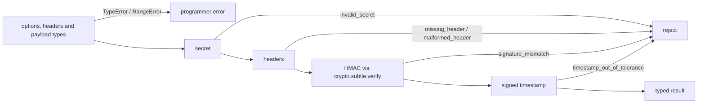

# webhook-signatures

[](https://github.com/aozmekik/webhook-signatures/actions/workflows/ci.yml)
[](LICENSE)

Verify webhook signatures from Stripe, GitHub, Slack, Shopify, Standard
Webhooks / Svix (Resend, Clerk), Twilio, Paddle and Lemon Squeezy with nothing
but the Web Crypto API.

> **Status: early, v0.1.0. The API may change before a stable release.** Not
> yet published to npm.

## Why

Every provider signs webhooks slightly differently, and each official SDK
verifies only its own scheme. An application that receives webhooks from
several providers ends up shipping several SDKs, some built around
`node:crypto` and `Buffer`, just to compute HMACs, which is awkward on edge
runtimes. Hand-rolled verification is easy to get subtly wrong: comparing with
`===`, verifying a re-serialized JSON body, forgetting the replay window, or
accepting Stripe's `v0` test signatures.

This library implements each scheme from the provider's documentation, behind
one small, typed API, using only `crypto.subtle`.

## Features

- **Eight schemes**, each citing its official documentation in code and below.
- **Zero dependencies, Web APIs only**: runs unchanged on Node.js 22+, Vercel
  Edge, Cloudflare Workers, and other runtimes with Web Crypto.
- **Constant-time comparison by the platform**: tags are checked with
  `crypto.subtle.verify`; no hand-written comparison loop.
- **Secure defaults**: provider-documented replay windows (300 s, or 5 s for
  Paddle), checked in both directions, with an injectable clock.
- **Bounded work before authentication**: header parsing is linear in the
  header's length, and at most 10 candidate signatures per header are checked.
- **Secret rotation**: pass several secrets; multi-signature headers (Stripe,
  Svix, Paddle) are handled.
- **Typed results and stable error codes**: `WebhookVerificationError.code`
  is one of five documented values.
- **Raw body in any form**: `string`, `Uint8Array` (including Node `Buffer`) or
  `ArrayBuffer`; headers as a `Headers` object or a plain, case-insensitive
  record.
- **Tree-shakable**: one verifier costs 1.8 to 2.6 kB minified and gzipped.
- **Test helpers**: `sign*` functions produce valid headers for your own tests.
- **Cross-validated** against the official SDKs: their signatures verify here,
  and this library's signatures verify with them where the SDK can sign.

## Install

Not yet published to npm. Install from GitHub:

```sh
npm install github:aozmekik/webhook-signatures
```

To pin a release instead of tracking `main`, append its tag, for example
`github:aozmekik/webhook-signatures#v0.1.0`.

A git install runs the package's `prepare` script, which builds `dist/` with
TypeScript. For that one build, npm first installs the whole development
toolchain (the lockfile lists 448 packages, including the provider SDKs and
workerd used by the tests), so the first install takes noticeably longer than
a registry install. With `--ignore-scripts` nothing is built and the package
has no `dist/`.

Requires Node.js 22 or newer (or any runtime with `globalThis.crypto.subtle`).
The package is ESM. CommonJS code can `require()` it on Node.js 22.12+;
TypeScript then needs `"module": "node20"` or `"nodenext"`, because `"node16"`
rejects the import with TS1479.

## Quick start

```ts
import { WebhookVerificationError, verifyStripe } from 'webhook-signatures';

export async function POST(request: Request): Promise<Response> {
  const secret = process.env.STRIPE_WEBHOOK_SECRET; // "whsec_..."
  if (!secret) throw new Error('STRIPE_WEBHOOK_SECRET is not set'); // a 500, not a 400

  // 1. Read the raw body before anything parses it.
  const payload = await request.arrayBuffer();
  try {
    // 2. Verify it against the headers and the endpoint secret.
    await verifyStripe({ payload, headers: request.headers, secret });
  } catch (error) {
    // Log the code, tell the sender nothing. invalid_secret is your
    // configuration, so let it surface as a 500.
    if (error instanceof WebhookVerificationError && error.code !== 'invalid_secret') {
      console.warn(`rejected ${error.provider} webhook: ${error.code}`);
      return new Response('invalid webhook', { status: 400 });
    }
    throw error;
  }
  // 3. Only now parse it.
  const event = JSON.parse(new TextDecoder().decode(payload));
  return Response.json({ received: true, type: event.type });
}
```

Framework recipes for getting the raw body:
[Hono](examples/hono/app.ts),
[Next.js route handlers](examples/nextjs/app/api/webhooks/stripe/route.ts),
[Express (`express.raw`)](examples/express/app.ts),
[Cloudflare Workers](examples/cloudflare-workers/worker.ts) and
[`Deno.serve`](examples/deno/handler.ts). CI calls each handler with signed
requests under Node.js (Express over real HTTP, the others with a standard
`Request`); see [examples/](examples/README.md).

## Providers

| Provider                                         | Function                | Signature header(s)                                                  | Scheme                                                                    | Replay window (default)       |
| ------------------------------------------------ | ----------------------- | -------------------------------------------------------------------- | ------------------------------------------------------------------------- | ----------------------------- |
| [Stripe][stripe-docs]                            | `verifyStripe`          | `Stripe-Signature`                                                   | HMAC-SHA256, hex, over `t.body`; one `v1` per active secret; `v0` ignored | 300 s                         |
| [GitHub][github-docs]                            | `verifyGitHub`          | `X-Hub-Signature-256`                                                | HMAC-SHA256, hex, over the body (`sha256=` prefix)                        | none (not signed)             |
| [Slack][slack-docs]                              | `verifySlack`           | `X-Slack-Signature`, `X-Slack-Request-Timestamp`                     | HMAC-SHA256, hex, over `v0:ts:body`                                       | 300 s                         |
| [Shopify][shopify-docs]                          | `verifyShopify`         | `X-Shopify-Hmac-SHA256`                                              | HMAC-SHA256, base64, over the body                                        | none (not signed)             |
| [Standard Webhooks][sw-spec] / [Svix][svix-docs] | `verifyStandardWebhook` | `webhook-id`, `webhook-timestamp`, `webhook-signature` (or `svix-*`) | HMAC-SHA256, base64, over `id.ts.body`; key is the base64 `whsec_` secret | 300 s                         |
| [Twilio][twilio-docs]                            | `verifyTwilio`          | `X-Twilio-Signature`                                                 | HMAC-SHA1, base64, over URL + sorted form params; JSON via `bodySHA256`   | none (not signed)             |
| [Paddle Billing][paddle-docs]                    | `verifyPaddle`          | `Paddle-Signature`                                                   | HMAC-SHA256, hex, over `ts:body`; several `h1` during rotation            | **5 s** old (SDK), 60 s ahead |
| [Lemon Squeezy][lemon-docs]                      | `verifyLemonSqueezy`    | `X-Signature`                                                        | HMAC-SHA256, hex, over the body                                           | none (not signed)             |

[Resend][resend-docs] and [Clerk][clerk-docs] deliver webhooks through Svix:
verify them with `verifyStandardWebhook` and the endpoint's `whsec_...` secret.

## API

```text
// Every verifier: (options) => Promise<Result>, rejecting with WebhookVerificationError.
verifyStripe({ payload, headers, secret, toleranceSeconds?, now? })   // { provider, timestamp }
verifyGitHub({ payload, headers, secret })                            // { provider, deliveryId, event }
verifySlack({ payload, headers, secret, toleranceSeconds?, now? })    // { provider, timestamp }
verifyShopify({ payload, headers, secret })                           // { provider, webhookId, topic }
verifyStandardWebhook({ payload, headers, secret, toleranceSeconds?, now? }) // { provider, id, timestamp }
verifyTwilio({ payload, headers, secret, url, scheme? })              // { provider, scheme }
verifyPaddle({ payload, headers, secret, toleranceSeconds?, now? })   // { provider, timestamp }
verifyLemonSqueezy({ payload, headers, secret })                      // { provider, eventName }

// Provider chosen at runtime (for example from a route parameter); typed per provider.
verifyWebhook('github', { payload, headers, secret }) // Promise<GitHubVerifyResult>
```

- `payload`: the raw body, `string | Uint8Array | ArrayBuffer`. Passing a parsed
  object throws a `TypeError` that points at the body parser.
- `headers`: a `Headers` object or a plain record such as Node's `req.headers`.
- `secret`: a string, or an array of strings during a rotation.
- `toleranceSeconds`: only on schemes that sign a timestamp. `Infinity`
  disables the check; `0` means "not older than now".
- `now`: a `Date` to check the timestamp against (defaults to the current time).
- `url` (Twilio): the full URL Twilio requested, that is, the public origin
  plus the request's path and query, exactly as received, including any
  parameters Twilio appended (`bodySHA256`, GET parameters). For form POSTs
  that is the configured webhook URL.
- `scheme` (Twilio): `'form-params'` (default) or `'body-sha256'` for
  endpoints that receive JSON. It is never inferred from the URL
  ([ADR 0005](docs/adr/0005-twilio-scheme-per-endpoint.md)).

Fields such as GitHub's `deliveryId` or Shopify's `webhookId` come from headers
the provider does **not** sign; they are returned for convenience and
documented as such.

`verifyWebhook` references every verifier, so it brings all of them into a
bundle; import the specific function when the provider is known. When the
provider is a union type, the options must suit every member: `url` is
required as soon as `'twilio'` is possible.

### Errors

| `error.code`                 | Meaning                                                                                                                           |
| ---------------------------- | --------------------------------------------------------------------------------------------------------------------------------- |
| `missing_header`             | A required header is absent or blank.                                                                                             |
| `malformed_header`           | A header does not parse: bad encoding, wrong digest length, no supported scheme, conflicting duplicates, more than 10 signatures. |
| `signature_mismatch`         | Well-formed, but no signature matches any secret. The body changed, or the secret is wrong.                                       |
| `timestamp_out_of_tolerance` | The signature is valid but the signed timestamp is too old or in the future: replay or clock skew.                                |
| `invalid_secret`             | The configured secret is unusable (empty, not a string, not base64 for Standard Webhooks).                                        |

`error.provider` and `error.header` say where it happened. Messages are safe to
log: they never contain secrets or expected signatures, and they hint when a
secret has stray whitespace. Answer the first four codes with a plain 400 and
keep the code in your logs; `invalid_secret` is a configuration error and
belongs in a 500. Programmer errors (a parsed body, a negative tolerance, a
relative Twilio URL) throw `TypeError` / `RangeError` instead.

The checks always run in this order, so a timestamp error is only reported for
a request that was genuinely signed:



### Testing your handlers

`webhook-signatures/testing` exports one `sign*` helper per provider. They are
test utilities: production code only verifies.

```ts
import { signStripe } from 'webhook-signatures/testing';

const body = JSON.stringify({ id: 'evt_test', type: 'invoice.paid' });
const headers = await signStripe({ payload: body, secret: 'whsec_test' });
const response = await app.request('/webhooks/stripe', { method: 'POST', body, headers });
```

`signStripe`, `signStandardWebhook` and `signPaddle` accept a list of secrets
and emit one signature per secret, as those providers do during rotation.
`signTwilio` returns `{ url, headers }`, because for JSON bodies Twilio signs a
URL that carries the body hash.

## Replay protection

A valid signature proves who sent a request, not that it is the first delivery.
Providers retry, and anyone who captures a request can resend it.

- **Signed timestamps** (Stripe, Slack, Standard Webhooks, Paddle) bound the
  window; keep the defaults unless you have a reason.
- **Record processed ids** to close it, in two steps so that a failure does
  not lose the event: reserve the id with a short lease, do the work, then mark
  it done, or release it if the work failed so the provider's retry is
  processed. Best of all, write the id in the same database transaction as
  the side effect, behind a unique constraint.
  [examples/replay-protection](examples/replay-protection/store.ts) has the
  interface, a `processOnce` helper and an in-memory store.
- **Prefer ids that are signed**: Standard Webhooks' `id` (in the signed
  content), or event ids inside the signed body (Stripe `id`, Paddle
  `event_id`).
- **GitHub, Shopify, Twilio and Lemon Squeezy sign no timestamp.** Their
  delivery-id headers (`X-GitHub-Delivery`, `X-Shopify-Webhook-Id`) are not
  covered by the signature: they deduplicate the provider's own retries but
  cannot stop a deliberate replay. Make those handlers idempotent.

## Twilio: what a valid signature proves

Twilio's scheme has two properties no verifier can change: it appends
`name + value` for every parameter to the URL with no delimiters, and it
signs no timestamp. A valid `X-Twilio-Signature` therefore
proves that Twilio once signed this concatenated string. It does not prove
which split into parameters Twilio meant, or that the request is new:

- `Body=hi&From=%2B1555` and `Body=hiFrom%2B1555` sign the same string
  (`BodyhiFrom+1555`), and a repeated identical pair (`A=1&A=1`) verifies like
  a single one (following twilio-node).
- A captured request verifies forever.

So, in Twilio handlers:

- Parse the body with `URLSearchParams` and read single values with `get()`;
  reject unexpected or repeated names, and check that the parameters you need
  are present.
- Make processing idempotent on `MessageSid` / `CallSid`.
- Pass `scheme: 'body-sha256'` only on endpoints that receive JSON, and keep
  JSON and form callbacks on separate URLs.

## Design notes

- [ADR 0001](docs/adr/0001-web-crypto-only.md): only Web Crypto and other
  Web-standard globals; enforced by the build, lint and two isolated runtimes.
- [ADR 0002](docs/adr/0002-signature-comparison.md): comparison through
  `crypto.subtle.verify` for every (secret, signature) pair, with at most 10
  candidates per header.
- [ADR 0003](docs/adr/0003-esm-only.md): ESM only, built with `tsc`, to avoid
  the dual-package hazard for `instanceof WebhookVerificationError`.
- [ADR 0004](docs/adr/0004-error-model-and-check-order.md): error codes, check
  order, replay windows in both directions, and why signed bytes are never
  re-serialized.
- [ADR 0005](docs/adr/0005-twilio-scheme-per-endpoint.md): why the Twilio
  scheme is configured per endpoint instead of inferred from the URL.

Trade-off worth knowing: the API is `async` because `crypto.subtle` is, and on
Node.js each Web Crypto call has a fixed cost that synchronous `node:crypto`
does not (see [Performance](#performance)).

## Testing

CI is configured to run everything below on Node 22 and 24 (Ubuntu). The counts
in this section come from a local run on an Apple M1 Pro (16 GB), macOS 26,
Node v22.22.3, Vitest 5.0.5; Node 24 has not been run locally.

- **Conformance suite**, run once per provider: round trip, tampering, wrong and
  rotated secrets, header casing, `Headers` objects, Node header arrays,
  payload types, empty bodies, concurrent requests, check order, linear-time
  parsing of a megabyte of header padding, replay windows at and past their
  bounds ([`test/unit/conformance.test.ts`](test/unit/conformance.test.ts)).
- **Published test vectors** from the GitHub, Slack, Twilio and Svix docs and the
  Standard Webhooks reference tests ([`test/unit/vectors.test.ts`](test/unit/vectors.test.ts)).
- **Malformed-header tables** for every documented format
  ([`test/unit/malformed-headers.test.ts`](test/unit/malformed-headers.test.ts)).
- **Regression tests for reported attacks**: the Twilio scheme-confusion
  forgery from ADR 0005 and the quadratic header trim
  ([`test/unit/providers.test.ts`](test/unit/providers.test.ts),
  [`test/unit/internal/headers.test.ts`](test/unit/internal/headers.test.ts)).
- **Property tests** (fast-check): sign/verify round trips, single-byte tamper
  detection, and a parser fuzz that may only ever produce
  `WebhookVerificationError` ([`test/unit/properties.test.ts`](test/unit/properties.test.ts)).
- **Official SDKs** ([`test/interop/`](test/interop/)): signatures from this
  library go through each SDK's verifier, and, where the SDK can sign, its
  signatures go through this library: `stripe`, `@octokit/webhooks-methods`,
  `standardwebhooks`, `svix`, `resend`, `twilio`, `@paddle/paddle-node-sdk`,
  `@slack/bolt` (`verifySlackRequest`) and `@shopify/shopify-api`.
- **An independent oracle**: every scheme re-implemented in a few lines of
  `node:crypto` and compared over generated inputs; the only cross-check for
  Lemon Squeezy, which ships no verification SDK
  ([`test/interop/node-crypto-oracle.test.ts`](test/interop/node-crypto-oracle.test.ts)).
- **Isolated runtimes**: the library is bundled for esbuild's `neutral` platform
  and run inside a fresh `@edge-runtime/vm` context and inside workerd via
  Miniflare, neither of which has `process`, `Buffer` or `require`
  ([`test/isolation/`](test/isolation/)).
- **Examples**: every handler in `examples/`, end to end ([`test/examples/`](test/examples/)).

`npm test` runs 853 tests: 460 in the Node project, plus the 393 unit and
property tests again under Vitest's `edge-runtime` environment.
`npm run test:coverage` reports 100% of statements (451/451), branches
(271/271), functions (66/66) and lines (447/447) in `src/`; the configured
threshold fails the run below that.

Runtime support: Node.js is tested directly (22 locally; 22 and 24 configured
in CI). The Vercel Edge Runtime is exercised through `@edge-runtime/vm`, and
Cloudflare Workers through workerd via Miniflare. Deno and Bun are not tested
yet; the library only uses APIs they implement.

## Performance

Measured on an Apple M1 Pro (16 GB), Node v22.22.3, with
`npm run build && npm run bench` and `npm run build && npm run size`. The
machine was shared with other jobs; [docs/benchmarks.md](docs/benchmarks.md)
has the full tables, the method and the load averages.

- **Time:** about 20 µs per verification for a 1 KiB body and 57 to 72 µs for
  64 KiB (fastest batch), when the body is passed as bytes. For comparison,
  stripe-node takes 3.5 µs and 78 µs on its synchronous `node:crypto` path.
  At small sizes the fixed cost of a Web Crypto call dominates. Passing a
  string instead of bytes costs a UTF-8 encode, which more than doubles the
  64 KiB time.
- **Size:** one verifier adds 1,767 to 2,609 bytes minified and gzipped
  (esbuild 0.28.2); `verifyWebhook`, which includes every provider, adds
  4,694.

## Limitations

- Asynchronous API only (Web Crypto is asynchronous).
- Symmetric (HMAC) schemes only. Standard Webhooks `v1a` (Ed25519) entries are
  skipped, not verified.
- GitHub, Shopify, Twilio and Lemon Squeezy sign no timestamp, so no replay
  window can be enforced for them (see [Replay protection](#replay-protection)).
- Twilio: see [what a valid signature proves](#twilio-what-a-valid-signature-proves).
  `url` must be the exact URL Twilio called; unlike twilio-node, no
  URL-normalization fallbacks are tried beyond the port. Form and JSON
  callbacks cannot share one endpoint.
- Paddle's 5 second default leaves little room for queues; verify on receipt
  or raise `toleranceSeconds`.
- At most 10 candidate signatures per header (see ADR 0002).
- The legacy GitHub `X-Hub-Signature` (SHA-1) header is not accepted.

## Roadmap

- Standard Webhooks `v1a` (Ed25519) asymmetric signatures.
- **iyzico**: not implemented. Its [webhook docs][iyzico-docs] describe
  `X-IYZ-SIGNATURE-V3` as HMAC-SHA256 over concatenated body fields, but the
  field list differs between integration types, field names are inconsistent
  (`paymentId` vs `iyziPaymentId`, `eventType` vs `iyziEventType`), and empty
  fields are not specified. It will be added once the algorithm can be
  implemented without guessing.
- Shopify "events" deliveries, which `@shopify/shopify-api` handles with
  `shopify-*` headers but which the public HTTPS-delivery docs do not describe yet.
- CI runs on Deno and Bun.
- Publishing to npm (see the note on the package name in
  [CONTRIBUTING.md](CONTRIBUTING.md#releasing)) and JSR.

## Contributing

See [CONTRIBUTING.md](CONTRIBUTING.md) for setup and the full command list
(`npm run ci` runs everything CI runs). Security issues: please follow
[SECURITY.md](SECURITY.md) and report privately.

## References

Implemented from the providers' documentation:
[Stripe][stripe-docs], [GitHub][github-docs], [Slack][slack-docs],
[Shopify][shopify-docs], [Standard Webhooks specification][sw-spec],
[Svix manual verification][svix-docs], [Twilio][twilio-docs] and
[Twilio webhook security][twilio-webhooks], [Paddle][paddle-docs],
[Lemon Squeezy][lemon-docs]; plus [RFC 2104](https://www.rfc-editor.org/rfc/rfc2104)
(HMAC), [RFC 4648](https://www.rfc-editor.org/rfc/rfc4648) (base64) and
[RFC 9110 section 5.6.3](https://www.rfc-editor.org/rfc/rfc9110#section-5.6.3)
(header whitespace). The official SDKs listed under Testing were read to confirm
behaviour the documentation leaves open (Twilio's port handling and repeated
parameters, Svix header aliases); no code was copied from them. Where an SDK
and the documentation disagree, the documentation wins: Twilio's docs say
URL credentials are dropped before signing, which this library does, while
twilio-node 6.2 keeps them.

[stripe-docs]: https://docs.stripe.com/webhooks?verify=verify-manually#verify-manually
[github-docs]: https://docs.github.com/en/webhooks/using-webhooks/validating-webhook-deliveries
[slack-docs]: https://docs.slack.dev/authentication/verifying-requests-from-slack
[shopify-docs]: https://shopify.dev/docs/apps/build/webhooks/subscribe/https
[sw-spec]: https://github.com/standard-webhooks/standard-webhooks/blob/main/spec/standard-webhooks.md
[svix-docs]: https://docs.svix.com/receiving/verifying-payloads/how-manual
[resend-docs]: https://resend.com/docs/webhooks/verify-webhooks-requests
[clerk-docs]: https://clerk.com/docs/webhooks/overview
[twilio-docs]: https://www.twilio.com/docs/usage/security#validating-requests
[twilio-webhooks]: https://www.twilio.com/docs/usage/webhooks/webhooks-security
[paddle-docs]: https://developer.paddle.com/webhooks/signature-verification
[lemon-docs]: https://docs.lemonsqueezy.com/help/webhooks/signing-requests
[iyzico-docs]: https://docs.iyzico.com/en/advanced/webhook

## License

[MIT](LICENSE)

Built by [Ahmed Semih Özmekik](https://github.com/aozmekik) at [Fergani](https://fergani.tr).
